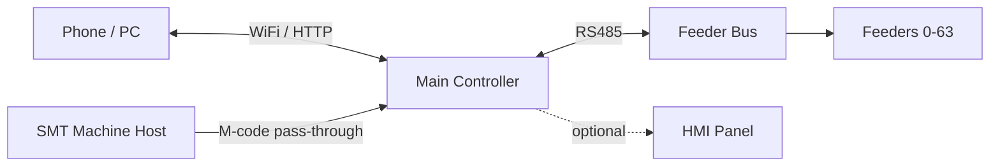

# DD Feeder Controller — Technical Manual

> 64-Channel RS-485 SMT Feeder Controller

> For developers, integrators, and maintenance staff. For site operation, see the [User Manual](user-manual.en.md).
>
> Firmware baseline: `26110205`; feeder firmware baseline: `2611102`.

## 1. Scope

| Topic | Location |
|---|---|
| Daily operation, Web UI, calibration, troubleshooting | [User Manual](user-manual.en.md) |
| Pins, interfaces, partitions, NVS, full image | [Hardware Interface](hardware-interface.en.md) |
| M-code, addressing, M620 parameters | §3 of this document |
| Communication protocol / API | `../API接口文档.md`, `../API接口文档.md` |
| Flashing procedure | [Flashing Guide](flashing-guide.en.md) |

## 2. Architecture



The Main Controller provides the Web UI over WiFi/HTTP and manages feeders over RS-485. The SMT machine can pass M-code through the serial port.

## 3. M-code Reference

### 3.1 Addressing

| Form | Meaning |
|---|---|
| `N<id>` (0–63) | Target that address (**N0 = device 0, not broadcast**) |
| No N | Implicit broadcast (all devices execute) |
| `N255` | Explicit broadcast |
| `P<chipid>` (6 hex digits) | Match the unique chip ID (address can change; ChipID is the final identity) |
| `N<id> P<chipid>` | Both address and ChipID must match |

### 3.2 Main Controller Commands (M900–M907, local, not forwarded to RS-485)

| Command | Function | Example |
|---|---|---|
| `M900` | System status | `M900` → `ok sys ver:… buzzer:1 vol:50 power:1 log:0 online:5 total:64 ip:…` |
| `M901 S0` / `S1` | Buzzer off / on | `M901 S1` |
| `M902 V0~100` | Buzzer volume | `M902 V60` |
| `M903 S0` / `S1` | Bus power off / on | `M903 S0` |
| `M904` | Full bus scan | `M904` |
| `M905` | Clear all feed counts | `M905` |
| `M906 S0` / `S1` | Debug log off / on | `M906 S1` |
| `M907` | Factory reset (clear all configuration and reboot) | `M907` → `ok factory reset` |

### 3.3 Feeder Commands (forwarded to RS-485)

| Command | Function | Example |
|---|---|---|
| `M600 F<mm>` | Feed (F required) | `M600 N5 F10`, `M600 P112233 F10` |
| `M601` | Retract after pickup | `M601 N1` |
| `M602 N<id>` | Query configuration/status (N required; `N255` = global scan) | `M602 N5` |
| `M603 A<angle>` | Manual servo angle | `M603 A90 N5` |
| `M610 S0` / `S1` | Disable / enable feeder | `M610 S1 N5` |
| `M611 P<chipid>` / `M612` | Blink / stop blink | `M611 P112233` |
| `M620 N<addr> A.. B.. C.. F.. U.. V.. W.. X.. [T..] [P<chipid>]` | Write feeder configuration | see §3.4 |
| `M799` | Feeder factory reset (broadcast, admin password required) | `M799` |
| `M788 [N<id>]` | Put feeder into ISP upgrade mode | `M788 N5` |

### 3.4 M620 Parameters

```text
M620 N5 A90 B44 C15 F4 U240 V550 W240 X0 T800 P112233
```

| Parameter | Meaning | Typical |
|---|---|---|
| `A` | Full-feed angle | 90 |
| `B` | Half-feed angle | 44 |
| `C` | Retract angle | 15 |
| `F` | Feed length (mm) | 4 |
| `U` | Settle time | 240 |
| `V` | Minimum pulse width (0° reference) | 550 |
| `W` | Maximum pulse width (90° reference) | 2400 |
| `X` | 0 = feedback wire present / 1 = ignored | 0 |
| `T` | N20 timeout (0–5000 ms; default 800) | 800 |
| `P` | ChipID (optional; match this device only) | 112233 |

### 3.5 Web Action ↔ M-code

| Web action | Equivalent M-code |
|---|---|
| Buzzer / volume | `M901 S1/S0` / `M902 V50` |
| Bus power | `M903 S1/S0` |
| Scan devices | `M904` (= `M602 N255`) |
| Clear counts | `M905` |
| Debug log | `M906 S1/S0` |
| Factory reset (Main Controller) | `M907` (Web requires password; pass-through does not) |
| Enable / disable feeder | `M610 S1/S0 P<chipid>` |
| Feed | `M600 F<mm> P<chipid>` |
| Servo angle | `M603 A<angle> P<chipid>` |
| Blink | `M611 P<chipid>` / `M612 P<chipid>` |
| Apply configuration | `M620 N<addr> … P<chipid>` |
| Feeder factory reset | `M799` (Web requires password) |

## 4. Storage and Upgrade

| Region | Content | OTA effect |
|---|---|---|
| NVS | WiFi, passwords, event log, feed count `feedcnt` | APP/page OTA does not touch NVS |
| app0/app1 | Main Controller firmware | APP OTA writes the app partition |
| LittleFS | Web page resources | Page OTA replaces page resources |
| otadata | OTA boot selection | Updated by OTA |

Feed count is stored in NVS and is not cleared by page upgrades. The full image `DDFC_<ver>_FULL.bin` is written from `0x0` and writes `0xFF` over the NVS at `0x9000`, clearing WiFi, passwords, counts, and the event log.

See [Hardware Interface §5](hardware-interface.en.md#5-storage-partitions-and-upgrade).

## 5. Related Documents

- [User Manual](user-manual.en.md)
- [Hardware Interface](hardware-interface.en.md)
- `../API接口文档.md`
- `../API接口文档.md`
- [Flashing Guide](flashing-guide.en.md)
