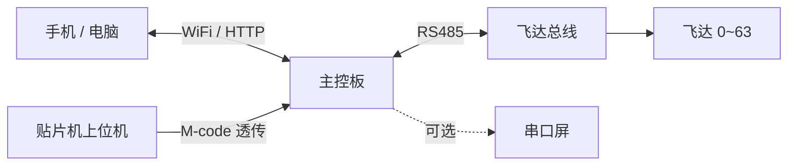

# DD 飞达控制器 — 技术手册

> 64 路 RS-485 SMT 飞达控制器

> 面向开发、集成与维护人员。现场操作请先看 [用户手册](user-manual.zh.md)。
>
> 固件基线：`26110205`；飞达固件基线：`2611102`。

## 1. 文档范围

| 内容 | 位置 |
|---|---|
| 日常操作、Web 页面、校准、故障处理 | [用户手册](user-manual.zh.md) |
| 引脚、接口、分区、NVS、FULL 镜像 | [硬件接口说明](hardware-interface.zh.md) |
| M-code、寻址、M620 参数 | 本文 §3 |
| 通信协议、API | [通信协议](../API接口文档.md)、[API 接口文档](../API接口文档.md) |
| 刷机步骤 | [刷机说明书](flashing-guide.zh.md) |

## 2. 系统架构



主控通过 WiFi/HTTP 提供 Web 页面，通过 485 管理飞达；贴片机可经串口透传 M-code。

## 3. M-code 命令参考

### 3.1 寻址规则


| 写法                   | 含义                                  |
| -------------------- | ----------------------------------- |
| `N<id>`（0\~63）       | 定向该地址（**N0 = 地址 0 的设备，不是广播**）       |
| 无 N                  | 隐式广播（所有设备执行）                        |
| `N255`               | 显式广播                                |
| `P<chipid>`（6 位十六进制） | 按芯片唯一 ID 匹配（**地址可改，ChipID 才是唯一标识**） |
| `N<id> P<chipid>`    | 地址 AND ChipID 都匹配才执行                |

### 3.2 主控本地命令（M900\~M907，主控本地执行，不转发 485）


| 命令            | 功能                | 示例                                                                           |
| ------------- | ----------------- | ---------------------------------------------------------------------------- |
| `M900`        | 系统状态查询            | `M900` → `ok sys ver:… buzzer:1 vol:50 power:1 log:0 online:5 total:64 ip:…` |
| `M901 S0` / `S1` | 蜂鸣器 关 / 开                                                                    |
| `M902 V0~100` | 蜂鸣器音量             | `M902 V60`                                                                   |
| `M903 S0` / `S1` | 总线电源 关 / 开                                                                   |
| `M904`        | 触发全量扫描            | `M904`                                                                       |
| `M905`        | 清零全部推料计数          | `M905`                                                                       |
| `M906 S0` / `S1` | 调试日志 关 / 开                                                                   |
| `M907`        | 恢复出厂设置（清空全部配置并重启） | `M907` → `ok factory reset`                                                  |

### 3.3 飞达命令（转发 485）


| 命令                                                               | 功能                           | 示例                               |
| ---------------------------------------------------------------- | ---------------------------- | -------------------------------- |
| `M600 F<mm>`                                                     | 进料（F 必填）                     | `M600 N5 F10`、`M600 P112233 F10` |
| `M601`                                                           | 取料后回退（下位机保留）                 | `M601 N1`                        |
| `M602 N<id>`                                                     | 查询配置 / 状态（N 必填；`N255`= 全局扫描） | `M602 N5`                        |
| `M603 A<角度>`                                                     | 舵机手动转角度                      | `M603 A90 N5`                    |
| `M610 S0` / `S1` | 禁用 / 使能飞达                        |
| `M611 P<chipid>` / `M612`                                        | 闪烁定位 / 停止闪烁                  | `M611 P112233`                   |
| `M620 N<addr> A.. B.. C.. F.. U.. V.. W.. X.. [T..] [P<chipid>]` | 写飞达配置                        | 见 §3.4                           |
| `M799`                                                           | 恢复出厂（广播，需管理密码）               | `M799`                           |
| `M788 [N<id>]`                                                   | 飞达进入 ISP 升级模式                | `M788 N5`                        |

### 3.4 M620 配置参数（写飞达参数）


```
M620 N5 A90 B44 C15 F4 U240 V550 W240 X0 T800 P112233
```


| 参数  | 含义                                | 典型值    |
| --- | --------------------------------- | ------ |
| `A` | 全进料角度                             | 90     |
| `B` | 半进料角度                             | 44     |
| `C` | 回退角度                              | 15     |
| `F` | 进料长度（mm）                          | 4      |
| `U` | 到位稳定时间                            | 240    |
| `V` | 电机最小脉宽（0° 基准）                     | 550    |
| `W` | 电机最大脉宽（90° 基准）                    | 2400   |
| `X` | 0 = 有反馈线 / 1 = 无反馈线               | 0      |
| `T` | N20 超时（0\~5000；不同电机转速需不同值，默认 800） | 800    |
| `P` | ChipID（可选，填了仅匹配该设备）               | 112233 |

### 3.5 Web 操作 ↔ M-code 等价表


| Web 操作        | 等价 M-code                           |
| ------------- | ----------------------------------- |
| 蜂鸣器开关 / 音量    | `M901 S1/S0` / `M902 V50`           |
| 总线电源          | `M903 S1/S0`                        |
| 扫描设备          | `M904`（= `M602 N255`）               |
| 清零计数          | `M905`                              |
| 调试日志开关        | `M906 S1/S0`                        |
| 恢复出厂设置（主控） | `M907`（Web 需密码；透传免密码）               |
| 使能 / 禁用飞达     | `M610 S1/S0 P<chipid>`              |
| 送料            | `M600 F<mm> P<chipid>`              |
| 舵机角度          | `M603 A<角度> P<chipid>`              |
| 闪烁定位          | `M611 P<chipid>` / `M612 P<chipid>` |
| 应用配置          | `M620 N<addr> … P<chipid>`          |
| 恢复出厂          | `M799`（Web 需密码）                     |


***


## 4. 存储与升级

| 区域 | 内容 | OTA 影响 |
|---|---|---|
| NVS | WiFi、密码、事件日志、推料计数 `feedcnt` | APP/页面 OTA 不动 NVS |
| app0/app1 | 主控固件 | APP OTA 写 app 分区 |
| LittleFS | Web 页面资源 | 页面 OTA 替换页面资源 |
| otadata | OTA 启动选择 | 由 OTA 更新 |

推料计数保存在 NVS，页面升级不会清空；完整镜像 `DDFC_<ver>_FULL.bin` 从 `0x0` 写入，会把 `0x9000` NVS 写成 `0xFF`，因此会清空 WiFi、密码、计数和事件日志。

详见 [硬件接口说明 §5](hardware-interface.zh.md#5-存储分区与升级)。

## 5. 相关文档

- [用户手册](user-manual.zh.md)
- [硬件接口说明](hardware-interface.zh.md)
- [通信协议](../API接口文档.md)
- [API 接口文档](../API接口文档.md)
- [刷机说明书](flashing-guide.zh.md)
