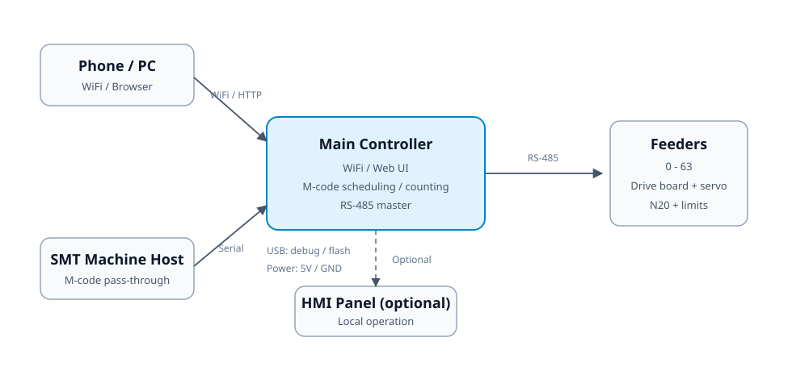

# DD Feeder Controller — User Manual

> 64-Channel RS-485 SMT Feeder Controller

> Applies to firmware `26110205` and later.
>
> Audience: **site operators and maintenance staff**. Covers daily operation, the Web UI, the optional HMI panel, and troubleshooting.
>
> Developers/integrators: see the [Technical Manual](technical-manual.en.md), [Hardware Interface](hardware-interface.en.md), `../API接口文档.md`, and `../API接口文档.md`.

## 1. System Overview

The **Main Controller** manages up to 64 SMT feeders on one **RS-485 bus**.

> A phone or PC accesses the Main Controller over WiFi. The SMT machine host can pass commands through the serial pass-through port. The Main Controller connects feeders 0–63 over RS-485. The HMI panel is optional.

### 1.1 External Interfaces

| Interface | Purpose | Notes |
|---|---|---|
| Power | 5 V supply | Use a stable 5 V supply |
| USB | Debug / flashing | On-board USB serial port |
| Host serial port | SMT machine | Command pass-through |
| Feeder bus | RS-485 | All feeders, A/B/GND |
| Display port | HMI panel (optional) | USART HMI, e.g. TJC |
| Factory-reset key | Inside the Main Controller | Hold 5 s; see §8.3 |

> Pin-level definitions, voltage levels, termination resistors, and partition addresses are in the [Hardware Interface](hardware-interface.en.md).

## 2. Quick Start

### 2.1 First Power-Up

1. Connect the RS-485 bus and feeder power, then power the Main Controller (USB or 5 V).
2. The device starts in **AP mode** by default (SSID `SMT-Feeder-AP`) unless WiFi has already been configured.
3. Connect a phone/PC to that AP and open `192.168.4.1` (or `http://smt-feeder.local`).

### 2.2 Connecting to a WiFi Network

1. Open the Web UI → **WiFi**.
2. Select or enter the router SSID and password → **Connect and Save**.
3. After the device switches to STA mode, use the IP assigned by the router (shown on the WiFi/Overview page and serial log), or open `http://smt-feeder.local` (mDNS; the client must support mDNS).

**Saved networks (top of the WiFi page):** up to **8** networks can be stored. On boot the device tries newest → oldest and uses the first successful one. **Delete** removes the entry and its password; it does not affect the current connection. A single WiFi entry saved by older firmware is migrated automatically.

> To enter AP mode: use **Switch to AP mode** on the WiFi page (persistent), or let the device fall back to AP when no saved network connects (`AP_FALLBACK`). Connecting to WiFi from the AP page returns the device to STA mode.

### 2.3 Login

- **Login is disabled by default** (equivalent to administrator). When enabled, a **username + password** is required.
- Factory default admin password: `123456`. **Change it after first login** (see §3.7).
- Session options: **20-minute idle timeout** or **permanent login** (until reboot).

### 2.4 Checking Normal Operation

1. The Overview shows the online count, e.g. `Online: 32/64`.
2. Click **Scan Devices**; all feeder cards should update (green = enabled, grey = disabled, red = conflict, purple = unconfigured).
3. One short beep (1200 Hz × 1) means the scan completed normally.

## 3. Web UI

Top navigation: **Overview / Terminal / Events / Upgrade / WiFi / Login Settings**.

Write actions (feed, enable, configure, calibrate, power, clear count, OTA, …) require **Unlock**. An administrator enters the password; the session re-locks after 5 minutes. Operators and unauthenticated users are read-only.

### 3.1 Overview (Home `/`)

| Area | Content |
|---|---|
| Top status bar | Online count / firmware version / signal strength / IP / total feed count |
| Top buttons | Scan devices, bus power on/off, buzzer on/off, volume slider, clear all counts |
| Regular feeders | 64 slot cards by address 0–63 |
| Temporary feeders | Above the regular slots: unconfigured (addr=99, purple) or address conflict (red) |

**Card colours:**

| Colour | Meaning | Action |
|---|---|---|
| Green | Enabled, ready to produce | Open details |
| Grey | Disabled | Open details and enable |
| Red ("Conflict" badge) | Two or more devices share the address | Open details; change address / use blink locator |
| Purple (addr=99) | Unconfigured (factory default) | Open details; set a valid address to move it into a regular slot |

**Buttons:**

| Button | Action | Notes |
|---|---|---|
| Scan Devices | Trigger a full bus scan | Bus is occupied for about 0.1–1 s |
| Bus Power | Turn all feeder power on/off | OFF = **all feeders lose power**; confirm line safety first |
| Buzzer | Master switch (green = on / red = off) | No unlock required |
| Volume | 0–100 slider, 300 ms debounce | Retained across power cycles |
| Clear Count | Clear **all** feeder feed counts | Irreversible |

### 3.2 Feeder Details (click any feeder card)

Shows enable/disable state, address, ChipID, firmware version, total feed count, and all configuration parameters (A/B/C/F/U/V/W/X/T).

> **Feed count storage:** stored in the Main Controller's non-volatile configuration area, not in the Web page resources. Upgrading the Web pages does not clear the count. Clearing the count, factory reset, or flashing a USB full image will clear it.

| Control | Description |
|---|---|
| **Enable / Disable** | Single toggle: "Disable Feeder" (green) when enabled, "Enable Feeder" (red) when disabled |
| **Feed** | Distance F2–F24 plus **Repeat ×N (1–999)**. Each round waits for the device `ok` before the next; error/timeout (3 s) stops the sequence |
| **Servo angle** | Manual 0° / 90° / 180° or custom angle (service use) |
| **Blink / Stop blink** | Toggle the on-board LED to locate the feeder (most useful for conflicts/unconfigured units) |
| **Servo calibration** | Automatically calibrate V/W at the 0° and 90° limits (see §6) |
| **Apply configuration** | Write A/B/C/F/U/V/W/X/T to this feeder in one operation |
| **Clear count** | Clear this feeder's feed count |
| **Factory reset** | Restore feeder defaults (unlock + admin password required) |
| **Query** | Send `M602` for a live refresh; cached values are shown on entry |

### 3.3 Terminal

- **Bus monitor:** live RS-485 TX (yellow) / RX (blue), refreshed every second.
- **Debug log:** grey italic `LOG` lines. Off by default; enable with **Debug log: On** (or `M906 S1`) to show WiFi, OTA, scan, and system messages. Keep it off in production.
- **Send command:** enter a command such as `M602 N5` or `M610 N5 S1`, then press Enter or **Send**.
  - M9xx commands (M900–M906) run locally on the Main Controller and reply `ok …` directly.
  - Other commands go to the RS-485 bus; replies appear in the monitor.
- **Dangerous commands** require the admin password:

| Command | Reason |
|---|---|
| `M799` | Factory reset (broadcast, irreversible) |
| `M788` | Put feeder into ISP upgrade mode |
| `M903 S0/S1` | Bus power (affects all feeders) |
| `M905` | Clear all counts |
| Broadcast writes (M600/M610/M620 without N/P targeting) | Affect the whole bus |

### 3.4 Events

Readable log of key events, auto-refreshed every 5 s, **last 16 entries retained across power loss**:

- system boot (firmware version and reset reason);
- bus power faults (auto-retry / latched off / recovered);
- OTA results (success / failure);
- colour coding: fault red / normal green / info blue / warning orange.

Time is real time (`YYYY-MM-DD HH:MM:SS`) when the Internet is reachable; otherwise uptime is shown (`uptime 3h25m`).

### 3.5 Upgrade

Online OTA; no wiring changes:

1. Click **Check for updates** to see current and available targets (Main Controller firmware / Web page resources / feeder devices).
2. Select targets (all is recommended) → **Start upgrade**.
3. Do **not** remove power or close the page during the upgrade. The device reboots automatically and beeps on success.
4. Reopen the page and verify the version.

> Upgrading Web pages only replaces page resources; it does **not** clear the feed count.
> Factory reset clears the Main Controller configuration and the feed count.

> **Feeder firmware is upgraded on a separate Feeder Upgrade page**, reached from **Upgrade selected feeders** on the Upgrade page or **Upgrade firmware** in the feeder control card. See below.

### 3.5.1 Feeder Upgrade Page (`feeder_upgrade.html`)

Upgrades one STC8H1K feeder driver board, with version comparison and anti-brick checks.

1. **Target:** when opened from the Upgrade page or feeder details, the target is filled in automatically. The target card shows the real RS-485 address (temporary feeder: `Temp 99`) and the 6-digit uppercase hex ChipID (e.g. `F724C4`). Click **Read** to query the board firmware version; this is asynchronous and usually returns in about 2 s. The page does **not** query automatically on entry. If the device is offline, re-enter the page or confirm that it is online.
2. **Firmware source** (choose one):
   - **Local upload:** select the feeder application package `DDF_<ver>_APP.hex` → **Upload and verify**. The device validates Intel HEX format, checksum, address range, and the `DDFW:` version tag; the package version is shown on success.
   - **GitHub online:** **Check GitHub latest** looks for a release containing `DDF_<ver>_APP.hex` (repository configured by `FW_GITHUB_OWNER` / `FW_GITHUB_REPO` in `config.h`).
3. **Version decision:** package newer than board → upgrade allowed; equal → skipped; older → enable **Force downgrade**.
4. **Start upgrade:** `M788` enters ISP boot → board is programmed (progress bar and live upgrade log) → device resets → version is read back and compared segment by segment.
5. Do not remove power or close the page during the upgrade. Success/failure is announced by beeps and recorded in Events.

> Write operations (upload/verify, start upgrade) require **Unlock**; the session normally expires after 20 minutes. Returning to the login page after expiry is expected.

> Anti-brick checks: (1) reject packages without a `DDFW:` tag; (2) reject invalid HEX/checksum/address range; (3) require the read-back version to match the package.

### 3.6 WiFi

- STA status: SSID / IP / signal strength.
- Connect a new network: see §2.2.
- AP mode: switch to the `SMT-Feeder-AP` hotspot for sites without a router or for recovery.

### 3.7 Login Settings (administrators only)

| Function | Description |
|---|---|
| Login required | Off = no login (administrator); On = login required |
| Change admin password | Old password + new password (≥4 characters) |
| Operator account | Username (not `admin`) + password (≥4 characters); **Clear operator** deletes it |
| Operator permissions | Read-only: browse pages, query, send read-only terminal commands (M602/M611/M612/M900–M906). **Write operations are rejected by the backend** |
| Factory reset | Enter the current admin password → clear all settings and reboot (see §8.3) |

## 4. HMI Panel (Optional)

The HMI panel is only a terminal; all logic runs on the Main Controller. Buttons send text lines (M-codes or `#` commands).

### 4.1 `#` Commands

| Command | Action |
|---|---|
| `#SCAN` | Trigger a full scan |
| `#STATUS` | Push a summary status to the screen |
| `#PWR 1` / `#PWR 0` | Bus power on / off |
| `#PING` | Link test (replies `PONG`) |
| `#PWD <admin password>` | Enter admin password (required before `M799`) |
| `#LOG 1` / `#LOG 0` | Debug log on / off (same as `M906 S1/S0`) |

### 4.2 Common HMI Actions

| Action | Command sent by HMI |
|---|---|
| Feed 4 mm at address 5 | `M600 N5 F4` |
| Enable / disable address 5 | `M610 N5 S1` / `M610 N5 S0` |
| Scan / query one feeder | `#SCAN` / `M602 N5` |
| Feeder factory reset (password first) | `#PWD 123456` → `M799` |
| Blink / stop blink | `M611 N5` / `M612 N5` |
| Bus power | `#PWR 0` / `#PWR 1` |

> HMI operations bypass the Web unlock flow. Confirm the feeder is stopped before acting. `M799` still requires the admin password.

## 5. Advanced Commands (Maintenance)

Daily operation does not require commands. Addressing rules, Main Controller commands (M900–M907), feeder commands (M600–M620, M799), and M620 parameters are in the [Technical Manual](technical-manual.en.md#3-m-code-reference).

## 6. Servo Calibration

### 6.1 Principle and Safety

- Goal: find the exact pulse widths (V/W) that just trigger the physical 0° and 90° limit switches, then write them back.
- Method: **incremental approach**. Start at 30° for 0° and 60° for 90°, step 1° toward the target, then back off 1° after triggering. The servo does not hit the limit or strip gears.
- Calibration only moves the servo and **writes no configuration**; values are written once only on success. Failure, abort, or closing the page leaves the parameters unchanged.
- Limit switches connect directly to the Main Controller calibration inputs (normally open, grounded when reached); no feeder firmware change is needed.

### 6.2 Procedure

1. Confirm the SMT machine is stopped and the feeder is idle (page confirmation + unlock).
2. Feeder details → **Servo calibration** → unlock → confirm.
3. Calibration runs automatically (0° and 90° normally complete within about 1 minute); progress is shown live.
4. Success: one short beep and `V=… W=…` written back. Failure: two short beeps; parameters unchanged.

### 6.3 During Calibration

- **Do not close or switch away from the page.** If the page is lost for 20 s, calibration aborts automatically (no write-back) and beeps twice.
- Write commands from the Web/HMI are rejected (`409` / `ERR CALIB`); queries are allowed.
- If only the 0° limit switch is installed, 90° calibration reports "not triggered". This is expected; install the 90° switch or set `CALIB_LIMIT90_PIN` to -1 in the build.

## 7. Buzzer Patterns

| Sound | Meaning | Action |
|---|---|---|
| 1 short (1200 Hz) | Success / scan complete / calibration OK | None |
| 2 short (700 Hz) | Command failed / calibration failed | Read the page message |
| N short (880 Hz, ≤3) | N new feeder errors | Check those feeders |
| 2 long (660 Hz) | Feeder offline (online count dropped) | Check bus / feeder power |
| 5 rapid (1320 Hz) | OTA failed | Retry OTA or use USB flashing |
| Rising double beep / 1 (1000 Hz) | OTA succeeded | Reload and verify version |
| 3 medium-long (1000 Hz) | **Bus power fault** (overcurrent/short) | See §8.2 |
| 2 low long (500 Hz) | Auto-retry stopped, **latched off** | Inspect hardware, then power on again |

> Fault/offline/power events beep only on the state change, not on every poll.

## 8. Bus Power and Fault Handling

### 8.1 Normal Switching

- Controlled from the Web Overview button, HMI `#PWR`, or host `M903`; all three stay in sync and the state survives power loss.
- **Power OFF = all feeders lose power.** Confirm line safety first.

### 8.2 Power Fault

Overcurrent, short, over-temperature, or output reverse bias pulls nFAULT low:

| Indication | Meaning |
|---|---|
| 3 beeps + Overview button turns red "Bus power: FAULT" | Fault detected; the Main Controller has tried one auto-reset |
| 2 beeps + latched off | Fault recurred within 5 s of reset; **auto-retry stopped**, manual action required |
| HMI status appends "Power fault!" | HMI notification |

**Troubleshooting:**

1. Use the beep count to identify the stage (3 = first fault, reset attempted; 2 = latched off).
2. Disconnect feeders in groups to isolate the short/overcurrent.
3. After fixing, turn power on again (Web / HMI / `M903 S1`) and watch for recurrence.
4. Check **Events** for details, e.g. `Bus power fault (auto-reset 1, total 3)`.

> nFAULT low does **not** always mean power is removed: in overcurrent the regulator may still current-limit. Only thermal shutdown fully disconnects. Persistent faults cause hiccup mode; the Main Controller latches off to avoid prolonged hiccup.

### 8.3 Factory Reset (Main Controller)

Use when the admin password, WiFi password, or configuration is lost.

| Method | Operation | When |
|---|---|---|
| **Internal key** | Hold the factory-reset key inside the Main Controller for **5 s** (one beep, then executes) | Device locked / Web unreachable |
| Web button | Login Settings → **Factory reset** → current admin password → confirm | Web still accessible |
| M907 | `M907` → `ok factory reset` (pass-through/HMI, no password) | Host / HMI |

**Cleared:** WiFi configuration, admin/operator accounts (back to `123456`), buzzer/power settings, event log, AP-mode flag. The device reboots to factory defaults (AP + default password).

**Not affected:** firmware version (this is not flashing), feeder configuration (use `M799` for feeders).

**Feed count:** cleared as well (stored in the Main Controller configuration area).

> Irreversible. Record necessary information first. Reconfigure WiFi and log in again (default password `123456`).
>
> **Reflashing only the Main Controller APP does not clear these settings.** Flashing a full image does; see §9.2. Reflashing the APP cannot recover a forgotten password; use this reset.

## 9. Firmware Upgrade

### 9.1 Online Upgrade (Recommended, see §3.5)

With Web access, the Main Controller firmware, pages, and feeders can be upgraded online without disassembly.

### 9.2 USB Flashing (Offline / Recovery)

See the [Flashing Guide](flashing-guide.en.md). Summary:

| File | Purpose |
|---|---|
| Full image `DDFC_<ver>_FULL.bin` | **Factory/recovery only**; clears all configuration and feed count |
| Main Controller firmware `DDFC_<ver>_OTA.bin` | Normal upgrade; keeps configuration |
| Web page package `DDFC_<fsver>_FS.bin` | Pages only; keeps configuration and count |

> **The full image is a factory image.** Its write range covers the Main Controller configuration area, clearing WiFi, passwords, feed count, and event log. For normal upgrades use Web OTA, or flash only the OTA/FS image.
>
> Addresses, partitions, and configuration-area details are in the [Hardware Interface](hardware-interface.en.md#5-storage-partitions-and-upgrade).

- Connect USB directly (on-board USB serial).
- After flashing, power-cycle and wait 10–20 s before opening the page; verify the version on the Overview.

## 10. Troubleshooting

| Symptom | Action |
|---|---|
| Web page does not open | Check AP/router connection; AP mode: `192.168.4.1`; STA mode: router-assigned IP or `http://smt-feeder.local` |
| Forgot admin/WiFi password | Hold the internal factory-reset key for 5 s (default password `123456`; reconfigure WiFi) |
| No feeders found | Check RS-485 A/B wiring, bus power, and feeder power |
| Feeder card shows red "Conflict" | Two or more devices share the address; use **Blink** to find one and change its address |
| Purple card addr=99 | Unconfigured; set a valid address 0–63 in details |
| Signal 0 dBm in AP mode | Normal: no access-point signal metric in AP mode |
| Buttons grey / not clickable | Operator/read-only account, or not unlocked |
| Events show uptime instead of time | No Internet/SNTP; normal in AP or offline mode |
| No terminal reply | Check addressing; calibration may be running (writes rejected) |
| Upgrade failed / bricked | USB-flash `DDFC_<ver>_FULL.bin @0x0` (see §9.2) |

## 11. Safety

1. **Bus power OFF removes power from all feeders.** Confirm line status first.
2. **Stop the SMT machine and confirm the feeder is idle before calibration**; do not close the page during calibration.
3. **Feeder factory reset (`M799`) is irreversible.** Broadcast operations require the admin password.
4. Operator accounts are read-only. Protect the admin password and change it after first login.
5. **Do not remove power or cables during upgrade/flashing.**
6. HMI operations bypass Web unlock; stop the machine before acting.

## 12. Glossary

| Term | Meaning |
|---|---|
| RS-485 bus | Communication bus between the Main Controller and feeders |
| ChipID | Unique 6-digit hex ID of each feeder MCU; the final device identity |
| Address (N) | Feeder bus address 0–63; addr=99 means unconfigured |
| Enable / Disable | Whether a feeder participates in production (disabled feeders ignore feed commands) |
| OTA | Over-the-air upgrade |
| Page resources | Web pages, scripts, styles, and related files |
| nFAULT | Power-switch fault output (low = fault) |
| V / W | Servo pulse widths for 0° / 90° |
| ISP | In-system programming of the feeder MCU (feeder firmware upgrade) |
| Factory reset | Clear the Main Controller configuration and reboot (internal key 5 s / Web button / M907) |
