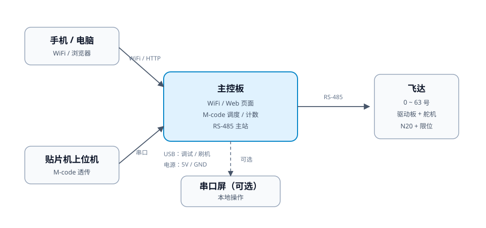

# DD 飞达控制器 — 用户手册

> 64 路 RS-485 SMT 飞达控制器

> 适用固件：
> `26110205`
> 及后续版本。
> 本文面向
> **现场操作员与维护人员**
> ，说明日常操作、Web 界面、串口屏、上位机指令与故障处理。
> 开发 / 集成人员请另见 [技术手册](technical-manual.zh.md)、[硬件接口说明](hardware-interface.zh.md)、`../API接口文档.md`、`../API接口文档.md`。

***

## 1. 系统概述

本控制器（下称“**主控**”）管理一条 **RS-485 总线**上的最多 64 台 SMT 飞达。

> 图：手机/电脑通过 WiFi 访问主控；贴片机上位机可经串口透传 上位机指令；主控通过 485 总线连接 0~63 号飞达；串口屏为可选件。

### 1.1 外部接口

| 接口 | 用途 | 说明 |
|---|---|---|
| 电源 | 5V 供电 | 建议使用稳定 5V 电源 |
| USB | 调试 / 刷机 | 板载 USB 串口 |
| 上位机串口 | 接贴片机 | 上位机指令透传 |
| 飞达总线 | RS-485 | 接全部飞达，A/B/GND |
| 显示屏接口 | 串口屏（可选） | 淘晶驰 USART HMI |
| 恢复出厂按键 | 主控板内部 | 长按 5 秒，见 §8.3 |

> 引脚级定义、电平、终端电阻、分区地址等，见 [硬件接口说明](hardware-interface.zh.md)。

## 2. 快速上手

### 2.1 首次上电

1. 接好 485 总线与飞达电源，给主控供电（USB 或 5V）。

2. 默认启动 **AP 热点**（WiFi 名 `SMT-Feeder-AP`）—— 除非已保存过 WiFi 配置。

3. 手机 / 电脑连接该热点，浏览器访问 `192.168.4.1`（或 `http://smt-feeder.local`）。

### 2.2 连接 WiFi（改用路由器网络）

1. 打开 Web 页面 → 顶部导航「**WiFi**」。

2. 选择或输入路由器 SSID 与密码 → 点「**连接并保存**」。

3. 设备切到 STA 模式后，用路由器分配的 IP 重新访问（IP 显示在 WiFi 页 / 总览页 / 串口日志），
   或直接用 `http://smt-feeder.local`（mDNS，IP 变化无影响，需手机/电脑支持 mDNS）。

**已保存网络（WiFi 页顶部）**：设备可记忆**最多 8 个** WiFi（每次连接并保存都会存进列表，重启后按最新→最旧依次尝试，先连上的即用）。每个条目右侧「删除」可移除（连密码一起删除，下次启动不再尝试；删除不影响当前连接）。旧固件保存过的单个 WiFi 会自动迁移进列表。

> 进入 AP 模式的两种方式：WiFi 页「切换到 AP 模式」（持久，重启仍为 AP）；或设备连不上已保存的 WiFi 时自动回退 AP（
> `AP_FALLBACK`
> ）。在 AP 页连接 WiFi 成功后自动回到 STA。

### 2.3 登录

* 默认**免登录**（等同管理员）；开启登录验证后需输入 **用户名 + 密码**。

* 出厂默认管理密码：`123456`（**首次使用请立即修改**，见 §3.7）。

* 登录时效二选一：**20 分钟失效**（无操作自动登出）或 **永久登录**（设备重启后失效）。

### 2.4 验证系统正常

1. 总览页显示在线台数（如 `在线:32/64`）。

2. 点「**扫描设备**」→ 全部飞达卡片亮起（使能绿 / 禁用灰 / 冲突红 / 未配置紫）。

3. 听到一声短鸣（1200Hz×1）= 扫描完成正常。

***

## 3. Web 界面操作手册

顶部导航页面：**总览 / 终端 / 日志 / 升级 / WiFi / 登录设置**。

写操作按钮（送料、使能、配置、校准、电源、清零、OTA…）需先「**解锁操作**」（管理员输入密码，5 分钟自动重锁）；操作员与未登录账号为只读。

### 3.1 总览页（首页 `/`）

| 区域    | 内容                                      |
| ----- | --------------------------------------- |
| 顶部状态条 | 在线台数 / 固件版本 / 信号强度 / IP / 累计推料数         |
| 顶部按钮区 | 扫描设备、总线电源（开 / 关）、蜂鸣器开关、音量滑条、清零计数        |
| 正式飞达区 | 64 个槽位卡片（按地址 0\~63）                     |
| 临时飞达区 | 位于正式槽位**上方**，未配置（addr=99，紫色）或地址冲突（红色）设备 |

**卡片颜色含义**：

| 颜色          | 含义            | 可做什么                |
| ----------- | ------------- | ------------------- |
| 绿           | 已使能，可生产       | 点击进详情页              |
| 灰           | 已禁用           | 点击进详情页启用            |
| 红（右上角 "冲突"） | 地址冲突（≥2 台同地址） | 点击进详情页处理地址 / 闪烁定位   |
| 紫（addr=99）  | 未配置（出厂默认）     | 点击进详情页配置地址后自动归入正式槽位 |

**按钮说明**：

| 按钮   | 操作                    | 注意                      |
| ---- | --------------------- | ----------------------- |
| 扫描设备 | 触发一次全量总线扫描            | 扫描期间（约 0.1\~1s）总线被占用    |
| 总线电源 | 开 / 关全部飞达电源           | 关闭 = **所有飞达断电**，先确认产线安全 |
| 蜂鸣器  | 总开关（绿 = 开 / 红 = 关）    | 不用解锁即可切换                |
| 音量   | 0\~100 滑条，防抖 300ms 生效 | 掉电保留                    |
| 清零计数 | 清零**所有**飞达推料计数        | 不可撤销                    |

### 3.2 飞达详情页（点击任意飞达卡片进入）

页面内容按设备状态显示：使能 / 禁用状态、地址、ChipID、固件版本、累计推料、全部配置参数（A/B/C/F/U/V/W/X/T）。

> **推料计数保存位置**：主控板的非易失配置区，不在 Web 页面资源中。
> 因此升级 Web 页面不会清空推料计数。清零计数、恢复出厂或刷入 USB 完整镜像会清空。

| 控件              | 说明                                                                         |
| --------------- | -------------------------------------------------------------------------- |
| **使能 / 禁用按钮**   | 单按钮：使能时显示「禁用飞达」（绿），禁用时显示「启用飞达」（红），点按切换                                     |
| **送料**          | 下拉选择距离（F2\~F24）+ **重复送料 ×N（1\~999）**；每轮等设备应答 `ok` 才推下一轮，出错 / 超时 3s 立即中断并提示 |
| **舵机角度**        | 手动转到 0° / 90° / 180° / 自定义角度（调试用）                                          |
| **闪烁定位 / 停止闪烁** | 单按钮切换；让设备板载 LED 闪烁以便在机台上找到它（冲突 / 未配置排障最常用）                                 |
| **舵机校准**        | 自动校准 0° 与 90° 限位对应脉宽 V/W（见 §6）                                             |
| **应用配置**        | 把页面上的 A/B/C/F/U/V/W/X/T 参数一次性写入该飞达                                         |
| **清零计数**        | 清零该飞达的推料计数                                                                 |
| **恢复出厂**        | 该飞达恢复出厂参数（需解锁 + 管理密码）                                                      |
| **查询**          | 实时向该飞达发 `M602` 刷新（进页时默认显示缓存）                                               |

### 3.3 终端页（导航「终端」）

* **消息浏览**：实时显示 485 总线收发（TX 黄 / RX 蓝，1s 刷新），与原日志页一致。

* **调试日志**：灰色斜体 `LOG` 行。默认关闭，用「调试日志：开」按钮（或 `M906 S1`）开启后，系统日志（WiFi 连接、OTA、扫描等）同时显示在此处。生产时建议关闭。

* **发送命令**：输入上位机指令行（如 `M602 N5`、`M610 N5 S1`），回车或点「发送」。

  * M9xx 系统命令（M900\~906）在主控本地执行，直接回显 `ok …`。

  * 其余命令发往 485 总线，设备回复进入下方消息区。

* **危险命令**（下表）发送前必须输入管理密码：

| 命令                               | 原因             |
| -------------------------------- | -------------- |
| `M799`                           | 恢复出厂（广播，不可逆）   |
| `M788`                           | 飞达进入 ISP 升级模式  |
| `M903 S0/S1`                     | 总线电源开关（影响所有飞达） |
| `M905`                           | 清零所有计数         |
| 广播写命令（无 N/P 定位的 M600/M610/M620…） | 影响整条总线         |

### 3.4 日志页（导航「日志」）

关键事件的可读化记录，自动刷新（5s），**掉电保留最近 16 条**：

* 系统启动（含固件版本与重启原因）

* 总线电源故障（自动复位 / 保持关断 / 恢复）

* OTA 升级结果（成功 / 失败）

* 各事件按类型着色：故障红 / 正常绿 / 信息蓝 / 注意橙

时间显示：连上互联网后为实时时间（`YYYY-MM-DD HH:MM:SS`）；离线时显示运行时长（`运行 3h25m`）。

### 3.5 升级页（导航「升级」）

在线 OTA，无需拆机接线：

1. 点「**检测更新**」→ 显示当前版本与可升级目标（主控固件 / Web 页面资源 / 飞达设备）。

2. 选择目标（建议全部选）→ 点「**开始升级**」。

3. 升级期间**不要断电、不要关闭页面**；完成后设备自动重启，听到成功提示音。

4. 升级完成后重新打开页面，核对版本号已更新。

> Web 页面升级只替换页面资源，**不会清空推料计数**。
> 恢复出厂会清空主控配置和推料计数。

> **飞达设备升级在独立「飞达升级页」完成**：从「升级」页（OTA）「升级所选飞达」按钮、或飞达详情页「飞达控制」卡片的「**升级固件**」按钮进入。见下节。

### 3.5.1 飞达升级页（`feeder_upgrade.html`，单独页面）

对单台 飞达驱动板做固件升级，带版本比对与防变砖校验：

1. **选择目标**：从「升级」页（OTA）或飞达详情页跳入时自动带出目标——「目标飞达」卡显示真实 485 地址（未配置的临时飞达显示 `临时 99`）与 6 位大写 hex ChipID（如 `F724C4`）；点「**读取**」查板上固件版本——异步执行，点击后约 2 秒经状态轮询回显。**进入页面不自动查询**（每次刷新都发 `M602` 没必要，详情页已查过），需要时手动点「读取」。若设备离线（临时飞达超时掉线）目标地址暂不可知，重新进入页面或确认设备在线即可。
2. **固件包来源**（二选一，选中的按钮高亮）：
   - **本地上传**：选从机工程编译出的 `feeder.hex` 文件 →「上传并校验」。设备端做 Intel HEX 格式/校验和/地址越界 + `DDFW:` 版本扫描，通过后显示包版本（如 `2610.2402`）。
   - **GitHub 在线**：「检查 GitHub 最新版」→ 检测最新 release 是否含 `feeder.hex` 资产（仓库在 `config.h` 的 `FW_GITHUB_OWNER`/`FW_GITHUB_REPO` 配置）。
3. **版本决策**（自动）：包>板 直接可升级；=板 会跳过；<板 需勾选「**强制降级**」才执行。
4. 点「**开始升级**」→ 流程：`M788` 进 ISP 引导 → 飞达驱动板 烧写（进度条 + **升级日志框**实时显示过程消息）→ 设备自动复位 → **回校**板上版本与包一致即成功。升级日志框**常显**（未升级时显示"等待升级…"，升级开始后增量追加）。
5. 升级期间**不要断电/关闭页面**；成功/失败均有提示音与事件记录（日志页可见）。

> 说明：写入类操作（上传校验 / 开始升级）需先「解锁操作」（弹窗确认），解锁成功后按钮才生效。会话默认 20 分钟过期，过期后页面跳回登录页属正常安全机制，重新登录即可。

> 防变砖保障：①包内无 `DDFW:` 标识（旧格式/错误文件）直接拒绝；②hex 格式/校验和/地址越界拒绝；③烧后回校版本逐段相等才算成功，不一致会报错提示。

### 3.6 WiFi 页（导航「WiFi」）

* STA 状态：当前连接的 SSID / IP / 信号强度。

* 连接新网络：见 §2.2。

* AP 模式：切到热点模式（`SMT-Feeder-AP`），用于无路由器现场或救援。

### 3.7 登录设置页（导航「登录设置」，仅管理员可见）

| 功能     | 说明                                                            |
| ------ | ------------------------------------------------------------- |
| 登录验证开关 | 关 = 免登录（等同管理员）；开 = 必须登录                                       |
| 修改管理密码 | 旧密码 + 新密码（≥4 位）                                               |
| 操作员账号  | 用户名（≠admin）+ 密码（≥4 位）；「清除操作员」删除该账号                            |
| 操作员权限  | 只读：可浏览所有页面、查询、终端发只读命令（M602/M611/M612/M900\~906），**写操作后端强制拒绝** |
| 恢复出厂设置 | 输入当前管理密码 → 清空全部设置并重启，回到出厂默认（见 §8.3）                           |

***

## 4. 串口屏操作（可选硬件）

串口屏仅做收发界面，逻辑全部在主控。屏幕按钮发文本行（M 代码直通或 `#` 命令）。

### 4.1 `#` 命令

| 命令                  | 作用                      |
| ------------------- | ----------------------- |
| `#SCAN`             | 触发一次全量扫描                |
| `#STATUS`           | 立即推送一次汇总状态到屏幕           |
| `#PWR 1` / `#PWR 0` | 485 总线电源 开 / 关          |
| `#PING`             | 联调测试（回 `PONG`）          |
| `#PWD <管理密码>`       | 输入管理密码（通过后才允许 `M799`）   |
| `#LOG 1` / `#LOG 0` | 调试日志开关（等价 `M906 S1/S0`） |

### 4.2 屏幕常用操作（按钮脚本示例）

| 操作           | 屏幕发送                        |
| ------------ | --------------------------- |
| 地址 5 进料 4mm  | `M600 N5 F4`                |
| 地址 5 使能 / 禁用 | `M610 N5 S1` / `M610 N5 S0` |
| 扫描 / 查询单台    | `#SCAN` / `M602 N5`         |
| 恢复出厂（先输密码）   | `#PWD 123456` → `M799`      |
| 闪烁定位 / 停止    | `M611 N5` / `M612 N5`       |
| 总线电源         | `#PWR 0` / `#PWR 1`         |

> 屏幕操作
> **不经过 Web 解锁流程**
> ：人就在设备旁，请确认飞达已停止再操作；
> `M799`
> 仍需管理密码。

***

## 5. 高级指令（维护人员）

日常操作不需要上位机指令。寻址规则、主控本地命令（M900~M907）、飞达命令（M600~M620、M799）和 M620 参数表，见 [技术手册](technical-manual.zh.md#3-m-code-命令参考)。

## 6. 舵机校准

### 6.1 原理与安全

* 校准目标：找出舵机**刚好触发物理 0° / 90° 限位开关**的精确脉宽（V/W），写回设备。

* 方法：**递加逼近**—— 从安全角度（0° 从 30° 起步、90° 从 60° 起步）逐 1° 逼近目标，触发后回退 1° 确认，**不会撞击限位、不会扫齿**。

* 校准过程只驱动舵机、**不写任何配置**；**只有成功才一次性写回**。失败 / 中断 / 关页面，设备参数保持原样。

* 限位开关直连主控 校准限位接口（常开型，到位接地），**下位机零改动**。

### 6.2 操作步骤

1. **确认贴片机已停止、该飞达空闲**（页面确认弹窗 + 解锁双保险）。

2. 飞达详情页 →「舵机校准」→ 解锁 → 确认。

3. 校准自动进行（约 1 分钟内完成 0° 与 90°），页面实时显示进度。

4. 完成听到 1 声短鸣 → 显示 `V=… W=…`（成功写回）；失败听到 2 声短鸣，参数未改动。

### 6.3 校准进行中

* **请勿关闭或切换本页面**：页面失联 20 秒后校准自动中止（配置不会写回），蜂鸣 2 声提示。

* 校准期间，网页 / 屏幕的写命令被拒绝（返回 `409` / `ERR CALIB`），仅查询放行。

* 若硬件只有 0° 限位：90° 校准会报 "未触发"，属正常（需加装 90° 开关或由开发将 `CALIB_LIMIT90_PIN` 设为 -1）。

***

## 7. 蜂鸣器提示音含义

| 声音                 | 含义                  | 处理          |
| ------------------ | ------------------- | ----------- |
| 短鸣 1 声（1200Hz）     | 操作成功 / 扫描完成 / 校准成功  | 无需处理        |
| 短鸣 2 声（700Hz）      | 命令执行失败 / 校准失败       | 看页面提示原因     |
| 短鸣 N 声（880Hz，≤3 次） | 新增 N 台飞达报错          | 查看对应飞达状态    |
| 长鸣 2 声（660Hz）      | 有飞达离线（在线台数减少）       | 检查总线 / 飞达供电 |
| 急促连鸣 5 声（1320Hz）   | OTA 升级失败            | 重新升级或串口刷机   |
| 上扬双音 / 1 声（1000Hz） | OTA 升级成功            | 刷新页面核对版本    |
| 中长鸣 3 声（1000Hz）    | **总线电源故障**（过流 / 短路） | 见 §8.2      |
| 低频长鸣 2 声（500Hz）    | 电源自动重试被终止，**保持关断**  | 需人工排查后重新开电源 |

> 错误 / 离线 / 电源故障只响一次（状态变化瞬间），不随页面轮询重复鸣叫。

***

## 8. 总线电源与故障处理

### 8.1 正常开关

* 任意一端（Web 总览按钮 / 屏幕 `#PWR` / 上位机 `M903`）控制，三端状态同步，掉电保留。

* **关闭电源 = 所有飞达断电**：先确认产线安全再操作。

### 8.2 电源故障

过流、短路、过热或输出反压时，电源芯片拉低 nFAULT：

| 表现                         | 含义                             |
| -------------------------- | ------------------------------ |
| 蜂鸣 3 声 + 总览按钮变「总线电源：故障」（红） | 检测到故障，主控已尝试自动复位 1 次            |
| 蜂鸣 2 声 + 保持关断              | 复位后 5 秒内再次故障，**自动重试已停止**，需人工处理 |
| 屏幕状态文本追加「电源故障！」            | 屏幕同步提示                         |

**排查流程**：

1. 看蜂鸣次数判断阶段（3 声 = 首次故障已复位；2 声 = 已锁断）。

2. 断开部分飞达，缩小短路 / 过流范围。

3. 排除后重新开启电源（Web / 屏幕 / `M903 S1`），观察是否再次故障。

4. 关键事件可在「日志」页查看（如 `总线电源故障（已自动复位 1 次，累计 3 次）`）。

> 注意：nFAULT 拉低
> **不代表断电**
> （过流时限流仍在供电）；只有热关断才真正断开。故障持续时芯片会热打嗝（开 - 关 - 开），主控的自动锁断正是为了避免长时间打嗝。

### 8.3 恢复出厂设置（主控）

忘记管理密码 / WiFi 密码 / 配置错乱时，恢复出厂让设备回到全新状态。

| 方式        | 操作                                            | 适用                    |
| --------- | --------------------------------------------- | --------------------- |
| **硬件长按键** | 按住 主控板内部恢复出厂按键 **5 秒**（蜂鸣 1 声提示后自动执行） | 设备被锁死 / Web 打不开（唯一兜底） |
| Web 按钮    | 登录设置页「恢复出厂设置」→ 输入当前管理密码 → 确认                  | 还能登录时                 |
| M907      | `M907` → `ok factory reset`（透传 / 屏幕免密码）       | 上位机 / 串口屏             |

**恢复内容**：WiFi 配置、管理密码 / 操作员账号（回默认 `123456`）、蜂鸣器 / 电源设置、事件日志、AP 模式标志 —— 全部清空后重启，回到出厂默认（AP 热点 + 默认密码）。

**不影响**：固件版本（不是刷机）、飞达配置（飞达请用 `M799`）。

**会清空**：推料计数（保存在主控配置区，恢复出厂会一起清）。

> ⚠️ 不可逆；执行前先记录必要信息。恢复后需重新配网并登录（默认密码
> `123456`
> ）。
> 注意：
> **只重刷主控固件（APP）不会清除这些配置**；刷入完整镜像会清空，见 §9.2。忘记密码时重刷 APP 无效，请用本功能。
> 详见
> `../恢复出厂设置说明.md`
> 。

***

## 9. 固件升级

### 9.1 在线升级（推荐，见 §3.5）

设备能访问 Web 即可在线升级 主控固件、页面、飞达设备，无需拆机。

### 9.2 串口烧录（离线 / 变砖恢复）

详见 [刷机说明书](flashing-guide.zh.md)，要点：

| 文件 | 用途 |
|---|---|
| 完整镜像（`DDFC_<ver>_FULL.bin`） | **仅出厂/救砖**，会清空全部配置和推料计数 |
| 主控固件（`DDFC_<ver>_OTA.bin`） | 日常主控升级，保留配置 |
| Web 页面包（`DDFC_<fsver>_FS.bin`） | 仅更新页面，保留配置和计数 |

> ⚠️ **完整镜像是出厂镜像**：写入范围覆盖主控配置区，会清空 WiFi、密码、推料计数和事件日志。日常升级请用 Web 在线升级，或只烧主控固件/页面包。
>
> 完整镜像的地址、分区和配置区细节见 [硬件接口说明](hardware-interface.zh.md#5-存储分区与升级)。

* USB 口直连即可刷（板载 USB 串口）。

* 刷完断电重上电，等 10~20 秒再访问页面；核对总览页版本号一致。

***

## 10. 常见问题排查

| 现象                 | 处理                                      |
| ------------------ | --------------------------------------- |
| 打不开 Web 页面         | 检查是否连的设备热点 / 同一路由器；AP 模式用 `192.168.4.1`；STA 模式用路由分配的 IP 或 `http://smt-feeder.local` |
| 忘记管理密码 / WiFi 密码   | 按住 主控板内部恢复出厂按键 5 秒恢复出厂（默认密码 123456，需重新配网） |
| 总览扫不到飞达            | 检查 485 接线（A/B）、总线电源是否开启、飞达是否上电          |
| 某台飞达卡片红色 "冲突"      | 该地址有 ≥2 台设备：用「闪烁定位」找到并改地址，冲突消失自动恢复正常    |
| 卡片紫色 addr=99       | 未配置设备：进详情页设置合法地址（0\~63），成功即自动归入正式槽位     |
| 信号强度显示 0dBm（AP 模式） | 热点模式下无基站信号指标，属正常显示                      |
| 操作按钮是灰色 / 不可点      | 操作员 / 未登录账号只读；或未解锁（先「解锁操作」）             |
| 日志页时间是 "运行 x 小时"   | 未连互联网（AP 模式 / 无外网），SNTP 未同步，属正常         |
| 终端发命令无回复           | 确认命令寻址正确；检查是否校准进行中（写命令被拒）               |
| 升级失败 / 变砖          | 串口烧录完整镜像 `DDFC_<ver>_FULL.bin @0x0`（见 §9.2）        |

***

## 11. 安全注意事项

1. **总线电源关闭 = 所有飞达断电**，操作前确认产线状态。

2. **校准前确认贴片机停止、飞达空闲**；校准中不要关闭页面。

3. **恢复出厂（M799）不可逆**，广播级操作必须输入管理密码。

4. 操作员账号为只读设计；管理密码请妥善保管，首次登录后立即修改。

5. 升级 / 刷机过程中**不要断电、拔线**。

6. 屏幕操作不经过 Web 解锁，人在屏旁操作时同样先停机。

***

## 12. 术语表

| 术语      | 含义                                             |
| ------- | ---------------------------------------------- |
| 485 总线 | 主控与飞达的通信总线（RS-485）                             |
| ChipID  | 每台飞达芯片唯一的 6 位十六进制 ID，定位设备的最终依据                 |
| 地址（N）   | 飞达在总线上的编号 0\~63；addr=99 表示未配置                  |
| 使能 / 禁用 | 飞达是否参与生产（禁用不响应进料）                              |
| OTA     | 在线升级（Over-The-Air）                             |
| 页面资源 | Web 页面、脚本、样式等文件 |
| nFAULT  | 电源芯片故障输出脚（低电平 = 故障）                            |
| V / W   | 舵机 0° / 90° 对应 PWM 脉宽参数                        |
| ISP     | 飞达 MCU 的串行在线编程（升级飞达固件用）                        |
| 恢复出厂 | 清空主控全部配置并重启（主控板内部恢复出厂按键长按 5s / Web 按钮 / M907） |
